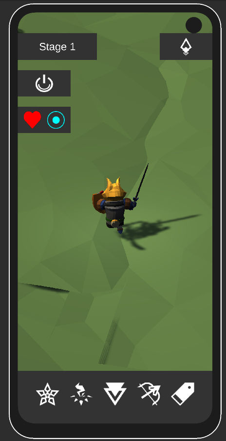
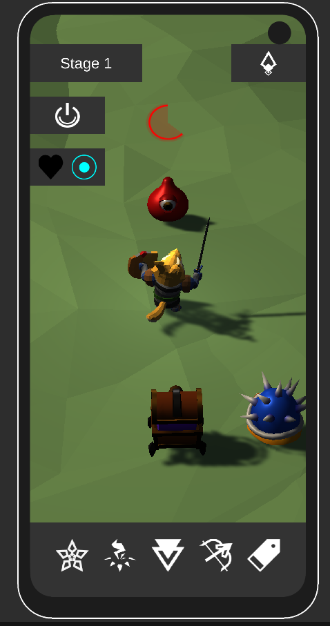
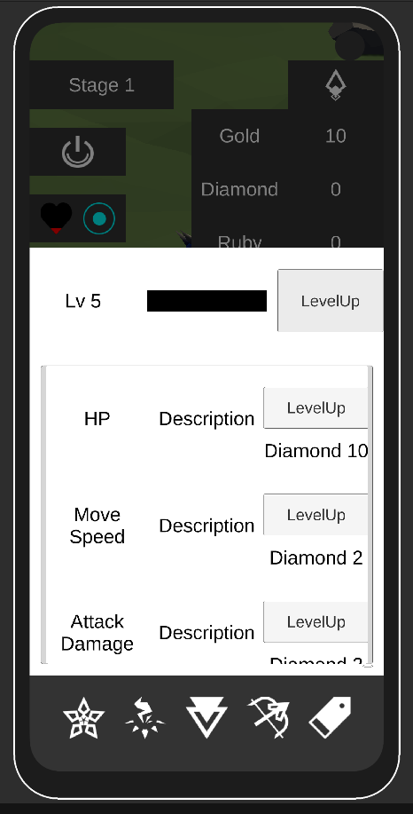
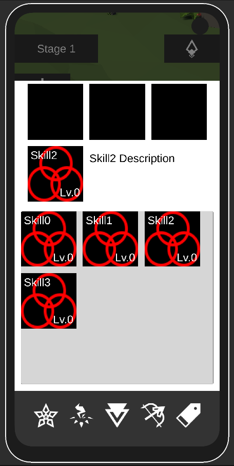
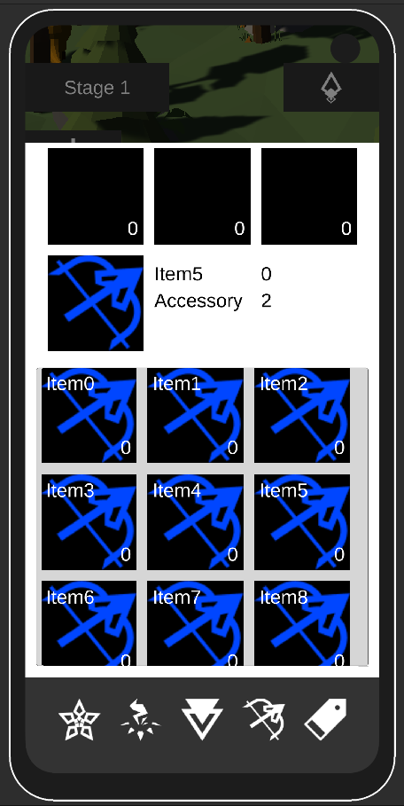
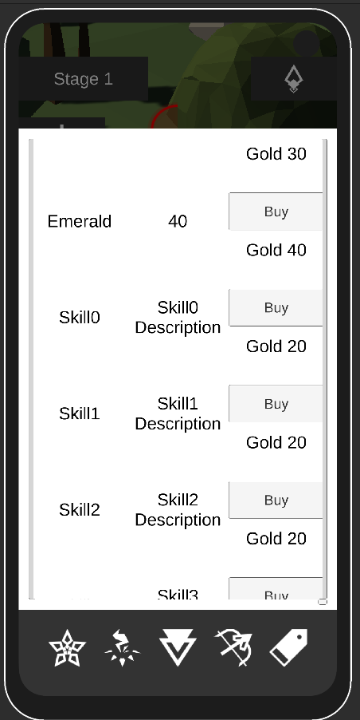

# 3D Neglecting Game

3D 방치형 액션 RPG (Unity, 2023~2024). 캐릭터가 스테이지를 자동으로 진행하고, 플레이어는 스킬 · 장비 · 능력치를 키운다.

  
  

- 스테이지 진행 · 스킬 · 장비 · 상점
- 데이터 저장 · 불러오기

> Asset Store 에셋을 사용해 실행 파일은 배포하지 않습니다.
